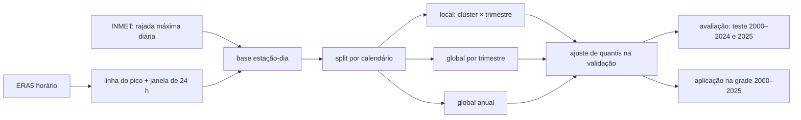

# Pipeline do modelo de correção de rajadas: dados, treino e validação

Este documento explica como os modelos que corrigem a rajada do ERA5 foram construídos, treinados e validados.
Também descreve o dataset de predições por estação, para quem quiser calcular as próprias métricas.

## 1. Objetivo

O ERA5 dá a rajada de vento (`gust10fg`) em toda a grade, de hora em hora, mas suaviza os picos. As estações
automáticas do INMET medem a rajada real, só que em poucos pontos. O modelo aprende, nas células com estação, a
levar o ERA5 até a rajada medida, e depois é aplicado a todas as células, inclusive às que não têm estação.

- **Alvo:** rajada máxima diária do INMET (`daily_wind_gust_max`, m/s).
- **Referência a vencer:** a rajada do ERA5 na hora do pico do dia, na célula da estação.

## 2. Como os dados foram estruturados

### 2.1 Regiões: clusters de regime de vento

O domínio foi dividido nos clusters de regime de vento do shapefile `dataset/shp/shp_vento.shp`. Cada cluster
reúne áreas com comportamento de vento parecido. Entram seis:

| cluster | região | estações | estação-dias | dias com vendaval (≥ 20 m/s) | vendaval a cada 1.000 dias | P99 do INMET (m/s) | anos |
|---|---|---|---|---|---|---|---|
| 1 | sul do RS (Pelotas, Jaguarão) | 9 | 26.375 | 454 | 17,2 | 21,3 | 2001–2025 |
| 2 | oeste e noroeste do RS | 16 | 84.400 | 906 | 10,7 | 20,1 | 2001–2025 |
| 3 | leste do RS (Porto Alegre, litoral norte) | 21 (9 com série antes de 2025)¹ | 42.785 | 635 | 14,8 | 21,0 | 2000–2025 |
| 4 | norte do RS e SC | 31 | 157.431 | 4.453 | 28,3 | 23,8 | 2001–2025 |
| 5 | norte de SC, PR, SP e sul do RJ | 21 | 107.430 | 500 | 4,7 | 17,9 | 2003–2024 |
| 12 | leste de MG, ES e RJ | 19 | 100.985 | 406 | 4,0 | 17,8 | 2006–2025 |

"Vendaval" aqui é a rajada INMET de 20 m/s (72 km/h) ou mais. A tabela sai de
`scripts/exportar_predicoes_estacoes.py`.

¹ No cluster 3, 12 das 21 estações só começaram a medir em setembro ou outubro de 2025, com 4 a 38 dias cada. Elas
não entram no treino nem no teste de 2000–2024; só aparecem em 2025. Na prática, o cluster 3 tem 9 estações.

**Por que essas regiões:**
- **O Sul concentra os vendavais.** Os clusters 1 a 4 (RS/SC) têm de 11 a 28 dias de vendaval a cada 1.000. Os
  clusters 5 e 12 ficam em 4 a 5. O cluster 4 sozinho soma mais de 60% dos dias de vendaval da base.
- **O Sul também concentra as estações com série longa.** São 77 estações em RS/SC, 31 delas no cluster 4. Mais
  estações dão mais exemplos de extremos para o modelo aprender e mais pontos para validar.
- **O cluster 3 foi a referência.** O estudo de seleção de variáveis e a triagem de algoritmos rodaram nele
  (seção 4). Depois a pipeline foi estendida aos outros clusters.
- **Os clusters 5 e 12 testam a correção fora do Sul.** São regiões com menos vendaval e outro regime de vento.

**Estações:** cada estação usa a célula ERA5 de 0,25° em que cai. Entram todas as estações com medida. Nas
métricas de extremo (seção 3), só contam as estações com pelo menos 365 dias no treino e 300 dias no teste.

### 2.2 Unidade de dado: uma linha por estação e dia

- **Linha:** um par (estação, dia), tomado na **hora do pico de rajada do ERA5** naquele dia e naquela célula.
- **Colunas:** 49 variáveis derivadas do ERA5 (documento 12). São campos na própria célula (rajada, vento a 10 e
  100 m, CAPE, precipitação convectiva, pressão), estatísticas na vizinhança (raios de 100 a 250 km), gradientes de
  pressão, defasagens das horas anteriores e a hora solar (seno). **O trimestre não é coluna:** nos modelos por
  trimestre ele define qual modelo é usado; o modelo anual recebe o dia do ano como seno e cosseno, num total de
  **51 colunas**.
- **Faltantes:** nada é imputado. Dias sem medida do INMET ou com alguma coluna faltando são descartados.
- **Janela da LSTM:** além da linha do pico, a LSTM recebe as **24 horas até o pico**, com as mesmas 49 colunas. A
  última hora da janela é idêntica à linha usada pelo ML.

## 3. Split e validação

O split é por calendário e é o mesmo em todas as regiões (`station_dataset.calendar_split`, seed 42). Ele usa
blocos de mês inteiros para que dias vizinhos, muito correlacionados, não fiquem um no treino e outro na avaliação.

| conjunto | dias | uso | linhas |
|---|---|---|---|
| **teste** | janeiro, abril, julho e outubro de 2000–2024 (um mês por trimestre) | avaliação final; nunca usado no ajuste | 167.246 |
| **validação** | blocos (ano, mês) sorteados nos outros meses, estratificados por mês | parada antecipada, escolha de modelo, ajuste de quantis | 53.048 |
| **treino** | o restante de 2000–2024 | ajuste dos pesos | 282.669 |
| **2025** | o ano inteiro | ano nunca visto, fora de tudo | 16.443 |

- **Purga:** nas fronteiras entre conjuntos são removidos os dias que as defasagens alcançariam
  (`purge_days(colunas)`), para nenhuma linha de avaliação carregar informação do treino.
- **Erro diário** (contra o INMET, por cluster): RMSE, viés e correlação.
- **Extremos:**
  - **Limiar:** o P95 e o P99 **de cada estação**, calculados **na série de treino do INMET** e aplicados sem
    mudança no teste. É a climatologia de referência da estação. Limiar e avaliação nunca usam os mesmos dias.
  - **Estações que contam:** só as que têm pelo menos 365 dias no treino e 300 dias no teste. Isso dá ≥ 3 eventos
    P99 esperados por estação e evita um P99 definido por um único dia. Ficam de fora estações recentes; os clusters
    1 e 3 ficam com 4 e 8 estações.
  - **Medidas:** **POD**, a fração dos dias extremos medidos que a previsão também pôs acima do limiar; **FAR**, a
    fração dos alarmes que eram falsos; e **CSI**, acertos ÷ (acertos + perdas + falsos alarmes), que junta as duas.
    Os eventos são somados entre as estações do cluster.
- **Significância:** a diferença de RMSE entre dois modelos tem intervalo de confiança de 95% por **bootstrap de
  blocos (ano, mês)** do teste, com 2.000 reamostragens, que preserva a correlação entre dias e entre estações do
  mesmo mês. Há também o **teste de Wilcoxon pareado por estação**, sobre o erro quadrático médio de cada estação
  (`scripts/revisao_metricas.py`).

## 4. Algoritmos de ML considerados

1. **Triagem:** os **39 regressores do LazyPredict** (`worker.select_regressors("all")`, com o mesmo filtro de
   `cluster_lazy`) foram ajustados no cluster 3, um conjunto por trimestre. Entre eles estão modelos lineares
   regularizados, k-vizinhos, SVR, árvores e florestas, boosting (GradientBoosting, HistGradientBoosting, XGBoost,
   LightGBM, CatBoost) e redes MLP.
2. **Campeões por trimestre**, escolhidos pela validação:

   | trimestre | campeão |
   |---|---|
   | DJF (verão) | MLP |
   | MAM (outono) | ExtraTrees |
   | JJA (inverno) | CatBoost |
   | SON (primavera) | HistGradientBoosting |

   Os modelos de ML **locais** e **globais por trimestre** usam esses campeões.
3. **Modelo anual:** o **ML global anual** usa **CatBoost**, o único algoritmo entre os 5 melhores nos quatro
   trimestres.

   **Ressalva sobre os campeões por trimestre.** Não há razão física para um algoritmo ser melhor no verão e outro no
   outono. Os campeões vieram da validação de um só cluster, com 9 estações, e a diferença entre os primeiros
   colocados de cada trimestre é pequena, então a troca de algoritmo entre trimestres é provavelmente ruído de
   seleção. O resultado confirma isso: o **CatBoost único para o ano todo** ganha do ML global por trimestre em todos
   os clusters (seção 8). A recomendação, portanto, é um algoritmo só com o dia do ano como coluna.
4. **Descartados:** busca de hiperparâmetros com Optuna, peso extra nos dias de pico e perdas assimétricas
   (expectil e Huber no ML). Sobreajustaram a validação e ficaram piores no teste.

## 5. Arquitetura da LSTM

| item | valor |
|---|---|
| entrada | janela de 24 horas × 49 colunas (51 no modelo anual, com seno e cosseno do dia do ano), padronizadas com média e desvio do treino |
| camadas | LSTM(96) → Dropout(0,3) → Dense(1) |
| perda | Huber (δ = 1) |
| otimizador | Adam, taxa de aprendizado 1e-3 |
| treino | lotes de 64, até 50 épocas, parada antecipada com paciência 5 sobre a perda de validação, mantendo os melhores pesos |
| saída | rajada máxima diária (m/s), cortada em [0, 80] |
| seed | 42 |
| execução | GPU T4 no Modal (`src/modal/global_lstm.py`) |

Código: `src/feature_study/core/worker_lstm.py` (`DEFAULTS`, `fit_arm_lstm`) e
`src/feature_study/diagnostics/regional_lstm.py`.

## 6. Estratégias de treino

As duas famílias (ML e LSTM) foram treinadas em três escalas, com as mesmas linhas, o mesmo split e as mesmas
colunas:

| modelo | quantos modelos | treina com |
|---|---|---|
| **local** | 6 clusters × 4 trimestres = 24 | as estações do próprio cluster, um trimestre |
| **global por trimestre** | 4 | todos os clusters juntos, um trimestre |
| **global anual** | 1 | todos os clusters e o ano todo; 51 colunas (49 + seno e cosseno do dia do ano) |



**Testes de generalização**, que não são opções de produção:
- **LOCO:** treina com todos os clusters menos um e avalia no que ficou de fora.
- **Regional RS/SC:** treina só com os clusters 1–4.
- **Modelo do cluster 3:** aplicado aos outros clusters.

Sem estações da região no treino, nenhum deles melhora o ERA5. Isso vale **entre clusters**. A generalização
**dentro** de um cluster, para células sem estação, ainda não foi testada (seção 8.4).

## 7. Etapa final: ajuste de quantis

Minimizando o erro quadrático, os modelos comprimem a distribuição e subestimam os picos: o desvio-padrão sai
com 70% a 77% do medido, e o P99 de cada estação fica 3 a 4 m/s abaixo. Por isso, cada previsão passa por um
**mapeamento empírico de quantis**, `f(p) = Q_INMET(F_modelo(p))`:
- **não paramétrico:** usa 199 quantis empíricos, de 0,5% a 99,5%, com interpolação linear entre eles. Fora dessa
  faixa, aplica o mesmo deslocamento (INMET − modelo) do quantil extremo mais próximo;
- **ajustado na validação do próprio modelo**, nunca no teste;
- **uma curva por modelo, com todas as estações do treino juntas.** Não há curva por estação. Os modelos por
  trimestre têm uma curva por trimestre; o local, uma por cluster e trimestre; o global anual, uma só para todos os
  clusters.

A ordem dos dias não muda; só a escala é esticada de volta. Os valores dos arquivos (seção 9) já incluem essa etapa.
Detalhes no documento 11.

**O ajuste troca erro diário por cauda.** Médias dos 6 clusters no teste 2000–2024, com limiar do treino:

| modelo | versão | RMSE | viés | erro do P99 da estação | desvio ÷ desvio do INMET | POD P99 | FAR P99 | CSI P99 |
|---|---|---|---|---|---|---|---|---|
| LSTM global anual | saída direta | **2,24** | +0,01 | −3,16 | 0,77 | 0,05 | 0,64 | 0,04 |
| LSTM global anual | com ajuste | 2,38 | +0,04 | −1,21 | 0,98 | **0,17** | 0,77 | **0,11** |
| ML global anual | saída direta | 2,35 | 0,00 | −3,26 | 0,72 | 0,05 | 0,69 | 0,04 |
| ML global anual | com ajuste | 2,52 | +0,02 | −0,74 | 0,98 | 0,19 | 0,83 | 0,10 |
| ML local | saída direta | 2,34 | 0,00 | −3,01 | 0,75 | 0,06 | 0,63 | 0,06 |
| ML local | com ajuste | 2,55 | −0,09 | −0,25 | 0,99 | 0,19 | 0,82 | 0,10 |

O ajuste **aumenta o RMSE** em 0,1 a 0,3 m/s em todos os modelos e clusters, como se espera de uma correção que
estica também os erros de fase. Em troca, ele triplica o POD e o CSI no P99 e corrige a variabilidade e o P99. A
**saída direta** é a melhor para o erro do dia a dia, e a **versão ajustada**, para percentis e extremos. Os
arquivos trazem a versão ajustada, porque o uso principal é a cauda. Tabelas completas em
`artifacts/feature_study/global/revisao/ablacao_*.csv`.

**Curva única para o modelo global.** Nos modelos globais, uma curva só serve a todos os clusters, e o resultado
piora onde o regime difere da média. No cluster 5, o P99 das estações fica 2,1 a 2,5 m/s abaixo do medido nos
modelos globais, contra +0,2 e −0,1 m/s nos modelos locais, que têm curva própria do cluster. Ajustar a curva por
cluster ou por estação é a correção recomendada (seção 8.4).

## 8. Resultados (meses de teste 2000–2024)

### 8.1 Erro diário

RMSE (m/s), versão ajustada; entre parênteses, a saída direta:

| modelo | 1 | 2 | 3 | 4 | 5 | 12 |
|---|---|---|---|---|---|---|
| ERA5 | 2,62 | 2,54 | 2,66 | 3,44 | 2,79 | 2,27 |
| ML local | 2,46 (2,27) | 2,57 (2,32) | 2,48 (2,40) | 2,95 (2,74) | 2,65 (2,34) | 2,18 (1,95) |
| ML global por trimestre | 2,73 (2,42) | 2,55 (2,30) | 2,73 (2,46) | 2,98 (2,84) | 2,57 (2,41) | 2,34 (2,08) |
| ML global anual | 2,55 (2,32) | 2,44 (2,26) | 2,62 (2,41) | 2,83 (2,72) | 2,45 (2,35) | 2,22 (2,02) |
| LSTM local | 2,68 (2,38) | 2,57 (2,34) | 2,57 (2,47) | 2,96 (2,72) | 2,61 (2,30) | 2,14 (1,92) |
| LSTM global por trimestre | 2,69 (2,45) | 2,52 (2,30) | 2,74 (2,47) | 2,99 (2,82) | 2,54 (2,37) | 2,22 (2,00) |
| **LSTM global anual** | **2,40 (2,21)** | **2,36 (2,22)** | 2,49 (2,33) | **2,69 (2,54)** | **2,35 (2,25)** | **1,99 (1,85)** |

**Significância** (diferença de RMSE, versão ajustada; IC 95% por bootstrap de blocos; Wilcoxon por estação):

| comparação | 1 | 2 | 3 | 4 | 5 | 12 |
|---|---|---|---|---|---|---|
| LSTM global anual − ERA5 | −0,22 [−0,29; −0,14] | −0,18 [−0,22; −0,14] ** | −0,17 [−0,22; −0,12] | −0,75 [−0,81; −0,68] ** | −0,45 [−0,50; −0,40] ** | −0,29 [−0,32; −0,25] ** |
| LSTM global anual − ML global anual | −0,15 [−0,20; −0,10] | −0,08 [−0,11; −0,06] ** | −0,13 [−0,18; −0,08] * | −0,14 [−0,17; −0,11] ** | −0,10 [−0,12; −0,09] ** | −0,23 [−0,26; −0,21] ** |
| LSTM global anual − ML local | −0,05 [−0,13; +0,01] | −0,22 [−0,32; −0,12] ** | +0,01 [−0,04; +0,05] | −0,26 [−0,31; −0,21] ** | −0,31 [−0,37; −0,24] ** | −0,19 [−0,24; −0,15] ** |
| ML global anual − ERA5 | −0,06 [−0,15; +0,01] | −0,09 [−0,13; −0,06] ** | −0,04 [−0,10; +0,02] | −0,61 [−0,67; −0,55] ** | −0,35 [−0,39; −0,30] ** | −0,05 [−0,09; −0,02] |

\** p < 0,01 e \* p < 0,05 no Wilcoxon. O cluster 1 tem só 4 estações elegíveis, poucas para o teste.

- A **LSTM global anual** erra significativamente menos que o ERA5 e que o ML global anual **em todos os clusters**.
- Contra o ML local, a vantagem é significativa em 4 clusters. Nos clusters 1 e 3 há empate.
- O ML global anual só melhora o ERA5 com segurança nos clusters 2, 4, 5 e 12.

### 8.2 Extremos (limiar P99 do treino de cada estação)

| modelo | POD 1 | 2 | 3 | 4 | 5 | 12 | FAR 1 | 2 | 3 | 4 | 5 | 12 | CSI 1 | 2 | 3 | 4 | 5 | 12 |
|---|---|---|---|---|---|---|---|---|---|---|---|---|---|---|---|---|---|---|
| ERA5 | 0,21 | 0,08 | 0,22 | 0,13 | 0,15 | 0,09 | 0,53 | 0,85 | 0,75 | 0,82 | 0,85 | 0,89 | 0,17 | 0,06 | 0,13 | 0,08 | 0,08 | 0,05 |
| ML local | 0,40 | 0,12 | 0,15 | 0,15 | 0,17 | 0,15 | 0,73 | 0,89 | 0,73 | 0,85 | 0,86 | 0,87 | 0,19 | 0,06 | 0,11 | 0,08 | 0,08 | 0,08 |
| ML global por trimestre | 0,32 | 0,16 | 0,28 | 0,13 | 0,12 | 0,17 | 0,77 | 0,85 | 0,82 | 0,85 | 0,81 | 0,89 | 0,15 | 0,08 | 0,12 | 0,07 | 0,08 | 0,07 |
| ML global anual | 0,31 | 0,16 | 0,27 | 0,15 | 0,10 | 0,15 | 0,77 | 0,84 | 0,81 | 0,83 | 0,81 | 0,88 | 0,15 | 0,09 | 0,12 | 0,08 | 0,07 | 0,07 |
| LSTM local | 0,24 | 0,11 | 0,12 | 0,14 | 0,14 | 0,13 | 0,86 | 0,89 | 0,71 | 0,85 | 0,89 | 0,89 | 0,10 | 0,06 | 0,09 | 0,08 | 0,07 | 0,06 |
| LSTM global por trimestre | 0,25 | 0,13 | 0,18 | 0,11 | 0,11 | 0,14 | 0,74 | 0,87 | 0,83 | 0,87 | 0,82 | 0,88 | 0,14 | 0,07 | 0,10 | 0,06 | 0,07 | 0,07 |
| **LSTM global anual** | 0,32 | 0,15 | 0,21 | 0,13 | 0,09 | 0,12 | **0,67** | **0,81** | 0,72 | **0,82** | **0,78** | **0,82** | **0,20** | **0,09** | **0,14** | 0,08 | 0,07 | **0,08** |

Estações e eventos P99 no teste: cluster 1, 4 estações e 80 eventos; 2, 15 e 285; 3, 8 e 156; 4, 30 e 550; 5, 21 e
395; 12, 19 e 312. No P95 o quadro se repete com números maiores: o CSI da LSTM global anual fica entre 0,19 e
0,30, contra 0,16 a 0,23 do ERA5 (`artifacts/feature_study/global/revisao/extremos_limiar_treino.csv`).

**Leitura:**
- **Detectar extremos diários no P99 é difícil para todos:** o CSI fica abaixo de 0,2, e 7 a 9 de cada 10 alarmes
  são falsos.
- **POD sozinho engana.** O ML local tem o maior POD no cluster 1 (0,40), mas com 73% de alarmes falsos.
- **Entre os modelos, a LSTM global anual tem o menor FAR** em 5 dos 6 clusters. No cluster 1, o ERA5 tem menos
  alarmes falsos (0,53), porque também detecta menos. Ela tem o maior CSI, ou empata no maior, em 5 clusters; a
  exceção é o cluster 5.
- **O cluster 5 é a exceção:** os modelos globais detectam menos que o ERA5 (POD 0,09 a 0,12 contra 0,15). O
  CSI quase não muda (0,07 contra 0,08), porque os falsos alarmes também caem. A causa provável é a curva de
  ajuste única dos modelos globais (seção 7), somada às colunas de vizinhança truncadas (seção 8.4). Os modelos
  locais do cluster 5 têm o mesmo truncamento e não perdem detecção.

### 8.3 O que os resultados sustentam

- A **LSTM global anual** é o melhor modelo único para o erro diário e tem o melhor equilíbrio entre detecção e
  alarmes falsos.
- O **ML global anual (CatBoost)** fica atrás da LSTM em todos os clusters, de 0,08 a 0,23 m/s, mas não precisa de
  GPU nem de janelas de 24 h.
- **Um modelo para o ano todo é melhor que um por trimestre**, nas duas famílias.
- A correção **vale nos pontos com estação, para dias e anos não vistos**. A aplicação a células sem estação é uma
  extrapolação que ainda não foi validada (seção 8.4).

### 8.4 Limites e ameaças à validade

**Validação espacial (o limite mais importante).**
- **O que o teste mede:** o split é só temporal. Toda estação está no treino e no teste, em meses diferentes, então
  o teste mede a **extrapolação no tempo nos mesmos pontos**.
- **O que fica sem resposta:** o projeto aplica o modelo a células sem estação, e essa generalização no espaço não é
  medida.
- **Correlação entre estações:** num mesmo dia, um sistema sinótico atinge várias estações vizinhas. Como os meses
  de teste são os mesmos para todas, isso não vaza informação do treino para o teste. Mas também não testa uma
  estação nunca vista.
- **O que já foi testado:** o LOCO, entre clusters, mostra que **sem estações da região nenhum modelo melhora o
  ERA5**.
- **O que falta:** uma validação **dentro do cluster**, com K-fold espacial por estação ou deixando uma estação de
  fora. Isso exige treinar de novo, ~1 h de GPU no Modal, e é o próximo passo antes de publicar mapas de grade como
  produto validado.

**Colunas do cluster 5.**
- **O problema:** o ERA5 do cluster 5 veio só com as células dentro do polígono. As 25 colunas de vizinhança e
  gradiente (raios de até 250 km) usam menos células que nos outros clusters, então não têm o mesmo significado
  físico. No teste com 59 células em comum, a pior delas tem correlação 0,53 com a versão completa.
- **A correção:** baixar de novo a caixa do cluster 5 com 250 km de borda e recalcular as colunas.
- **Enquanto isso:** os resultados dos modelos globais no cluster 5 devem ser lidos com essa ressalva.

**Ajuste de quantis com curva única.** A curva não é por estação. Estações em topo de serra ou no litoral e
estações em vale, dentro do mesmo cluster, recebem a mesma correção de cauda. A recomendação é ajustar por cluster
ou incluir a climatologia da estação.

**Assincronia entre o pico do ERA5 e o do INMET.**
- **O desencontro:** a linha é tomada na hora do pico do ERA5, e o alvo é o máximo do dia no INMET. Em frentes e
  convecção, o ERA5 adianta ou atrasa o evento em horas, ou não o representa, como numa tempestade isolada à tarde.
- **O que a LSTM vê:** a janela de 24 h até o pico do ERA5 mitiga em parte, e isso ajuda a explicar a vantagem da
  LSTM sobre o ML tabular. Mas a janela não vê o que vem **depois** do pico do ERA5.
- **Possíveis correções:** usar o dia inteiro centrado no pico ou a janela fixa de 00 a 23 UTC.

**Variáveis estáticas.**
- **O que falta:** as 49 colunas vêm do ERA5 de 0,25° (~25 km). Não há altitude da estação, diferença entre a
  altitude da estação e a do modelo, desvio do relevo dentro da célula nem distância da costa. Assim, o modelo não
  distingue uma estação em vale de outra em topo de morro na mesma célula.
- **Por que isso pesa:** isso afeta sobretudo os clusters 4, 5 e 12, de serra, e é uma explicação provável para a
  falha no LOCO.
- **O que já foi testado:** a rugosidade (`anor`) foi testada e retirada (documento 12). As outras variáveis
  estáticas ficam como trabalho futuro.

**Seeds e seleção.**
- **Seed:** cada ajuste usa uma seed (42). O intervalo de confiança da seção 8.1 cobre a variação entre meses de
  teste, mas não a variação entre seeds. Rodar 5 seeds na LSTM global anual e no CatBoost global anual (~30 min de
  T4) completa essa parte.
- **Seleção:** os campeões de ML vieram do cluster 3 (seção 4).

**Verão.** No DJF, as rajadas convectivas que o ERA5 não representa limitam todos os modelos.

**Cobertura.**
- **Cluster 5:** não tem 2025.
- **Clusters 1 e 3:** têm poucas estações, 9 cada (4 e 8 nas métricas de extremo).

## 9. Dados de predição: o que são e como usar

Há **um arquivo NetCDF por cluster**, cada um com tudo de que se precisa para aquele cluster:

| arquivo | cluster | grade (lat × lon) | células no cluster | estações | tamanho |
|---|---|---|---|---|---|
| `predicoes_rajada_cluster1.nc` | 1 — sul do RS | 13 × 12 | 71 | 9 | 15 MB |
| `predicoes_rajada_cluster2.nc` | 2 — oeste e noroeste do RS | 15 × 21 | 184 | 16 | 36 MB |
| `predicoes_rajada_cluster3.nc` | 3 — leste do RS | 10 × 10 | 74 | 21 | 15 MB |
| `predicoes_rajada_cluster4.nc` | 4 — norte do RS e SC | 16 × 26 | 214 | 31 | 44 MB |
| `predicoes_rajada_cluster5.nc` | 5 — norte de SC, PR, SP e sul do RJ | 17 × 17 | 154 | 21 | 32 MB |
| `predicoes_rajada_cluster12.nc` | 12 — leste de MG, ES e RJ | 22 × 22 | 124 | 19 | 29 MB |

Cada arquivo tem duas partes:
- **grade** `(time, lat, lon)`: a previsão em cada célula de 0,25° do cluster, para mapas, dashboard e uso onde
  não há estação;
- **estações** `(estacao, time)`, variáveis com prefixo `est_`: as previsões nas estações INMET do cluster, ao lado
  da rajada **medida**, para calcular métricas.

O período vai de 01/01/2000 a 31/12/2025, com 9.497 dias.

### 9.1 O que é cada valor

- **Valor:** a **rajada máxima diária prevista**, em m/s (multiplique por 3,6 para km/h). É a previsão para o dia
  inteiro, feita na hora do pico de rajada do ERA5 naquele dia e naquela célula.
- **Dia:** `time` é o dia do calendário.
- **Valores finais:** os números já são as previsões finais, com o ajuste de quantis da seção 7 aplicado. Não há
  outra etapa para aplicar.
- **Modelos** (mesmo nome na grade e, com `est_` na frente, nas estações):

  | nome | modelo | na grade | nas estações |
  |---|---|---|---|
  | `era5` | rajada do ERA5 (`gust10fg`) no pico do dia, **sem correção**; é a referência a vencer | sim | sim |
  | `ml_local` | ML treinado só com as estações deste cluster, um modelo por trimestre | sim | sim |
  | `ml_global_trimestral` | ML treinado com todos os clusters, um modelo por trimestre | sim | sim |
  | `ml_global_anual` | CatBoost treinado com todos os clusters e o ano todo | sim | sim |
  | `lstm_local` | LSTM treinada só com as estações deste cluster, uma por trimestre | sim | sim |
  | `lstm_global_trimestral` | LSTM treinada com todos os clusters, uma por trimestre | **não** | sim |
  | `lstm_global_anual` | LSTM treinada com todos os clusters e o ano todo; **a de menor erro** | sim | sim |
  | `inmet` | rajada máxima diária **medida** pelo INMET | — | sim (`est_inmet`) |

  Os modelos por trimestre já usam o ajuste do trimestre de cada dia (DJF, MAM, JJA, SON). Quem usa o arquivo não
  precisa fazer nada.

### 9.2 Variáveis do arquivo

| variável | dimensões | tipo | significado |
|---|---|---|---|
| `era5`, `ml_local`, `ml_global_trimestral`, `ml_global_anual`, `lstm_local`, `lstm_global_anual` | time, lat, lon | float32, m/s | previsão na grade |
| `celula_no_cluster` | lat, lon | int8 | 1 = célula do cluster; 0 = fora (valores vazios) |
| `est_inmet` | estacao, time | float32, m/s | rajada **medida** na estação |
| `est_era5`, `est_ml_local`, …, `est_lstm_global_anual` | estacao, time | float32, m/s | previsões na estação |
| `conjunto` | time | int8 | 0 treino, 1 validação, 2 teste, 3 = 2025, −1 sem dado |
| coordenadas `lat`, `lon` | — | graus | centro da célula |
| coordenadas `estacao`, `estacao_lat`, `estacao_lon` | estacao | texto, graus | código INMET e posição da estação |

Cada variável tem o atributo `long_name`, que descreve o modelo, e o arquivo traz `title`, `cluster` e
`conteudo` nos atributos globais.

### 9.3 Cuidados para não errar nas contas

- **Métricas só nos dias não vistos:** use apenas `conjunto == 2` (teste: jan/abr/jul/out de 2000–2024) e
  `conjunto == 3` (2025). Os dias de treino e validação foram vistos pelos modelos nas estações e dão números
  otimistas. Nas células sem estação, nenhum dia foi visto.
- **Valores vazios nas estações:** a estação fica vazia nos dias sem medida do INMET. Nas variáveis `est_lstm_*`,
  ficam vazios também os dias de treino e validação, porque essas previsões só foram guardadas para teste e 2025.
  Compare os modelos sempre nos mesmos dias.
- **Valores vazios na grade:** a grade é o retângulo que cobre o cluster, e as células de fora
  (`celula_no_cluster == 0`) ficam vazias. Nos dias 01 e 02/01/2000, as variáveis de LSTM ficam vazias porque falta
  a janela de 24 horas anteriores.
- **Cluster 5 sem 2025:** o cluster 5 não tem estações com dado em 2025, então ele só é avaliado no teste.
- **Extremos:** o limiar (P95, P99) é **de cada estação** e é calculado **nos dias de treino**
  (`conjunto == 0`) do `est_inmet`, depois aplicado ao teste. Não calcule o limiar com os próprios dias avaliados.
  Use só estações com pelo menos 365 dias de treino e 300 dias avaliados.
- **Ponto de grade da estação:** cada estação usa a célula ERA5 em que cai, e a célula do ERA5 tem ~25 km.
- **Juntar clusters vizinhos:** não há sobreposição, porque cada célula pertence a um único cluster. Para juntar,
  use só as células com `celula_no_cluster == 1` de cada arquivo.

### 9.4 Exemplos (Python, com `xarray`, `netCDF4` e `pandas`)

```python
import numpy as np
import xarray as xr

ds = xr.open_dataset("predicoes_rajada_cluster4.nc")
MOD = ["era5", "ml_local", "ml_global_trimestral", "ml_global_anual",
       "lstm_local", "lstm_global_trimestral", "lstm_global_anual"]

# --- métricas nas estações, só dias não vistos e os mesmos dias para todos os modelos
nv = ds.conjunto.isin([2, 3])
obs = ds.est_inmet.where(nv)
ok = obs.notnull()
for m in MOD:
    ok = ok & ds[f"est_{m}"].notnull()
for m in MOD:
    p, o = ds[f"est_{m}"].where(ok), obs.where(ok)
    rmse = float(np.sqrt(((p - o) ** 2).mean()))
    vies = float((p - o).mean())
    lim = ds.est_inmet.where(ds.conjunto == 0).quantile(0.99, dim="time")   # P99 do TREINO de cada estação
    ev, al = o >= lim, p >= lim
    pod = float((ev & al).sum() / ev.sum())
    far = float(((~ev) & al).sum() / al.sum())
    print(f"{m:24s} RMSE {rmse:.2f}  viés {vies:+.2f}  POD P99 {pod:.2f}  FAR P99 {far:.2f}")

# --- tabela das estações (uma linha por estação e dia), para Excel ou Power BI
tab = ds[[v for v in ds.data_vars if v.startswith("est_")] + ["conjunto"]].to_dataframe().reset_index()
tab = tab.dropna(subset=["est_inmet"])
tab.to_csv("estacoes_cluster4.csv", index=False)

# --- grade: série de uma célula, mapas da média e do P99 e correção por trimestre
serie = ds.lstm_global_anual.sel(lat=-27.6, lon=-48.5, method="nearest").to_series()
media = ds.lstm_global_anual.mean("time")
p99 = ds.lstm_global_anual.quantile(0.99, "time")
correcao = (ds.lstm_global_anual - ds.era5).groupby("time.season").mean("time")
dias_vendaval = (ds.lstm_global_anual >= 20).where(ds.celula_no_cluster == 1).groupby("time.year").sum("time")
```

Neste exemplo, o RMSE fica um pouco diferente das tabelas da seção 8. Ele junta o teste com 2025 e usa só os dias
em que todos os modelos têm valor, enquanto a seção 8 usa só o teste.

**Outras ferramentas:**
- **QGIS:** abre o arquivo como raster NetCDF. Escolha uma variável da grade e use `time` como dimensão temporal.
- **Panoply e ncview:** servem para inspeção rápida.
- **R:** use os pacotes `ncdf4` ou `terra`.

## 10. Como reproduzir

```bash
# base e janelas (no Modal, para não sobrecarregar a máquina local)
MODAL_PROFILE=<perfil> modal run src/modal/global_lstm.py --stage etapa --chaves adiciona-c5
MODAL_PROFILE=<perfil> modal run src/modal/global_lstm.py --stage etapa --chaves ml       # ML: todos os desenhos
MODAL_PROFILE=<perfil> modal run src/modal/global_lstm.py --stage fit --force             # LSTM em T4
MODAL_PROFILE=<perfil> modal run src/modal/global_lstm.py --stage etapa --chaves avaliar  # métricas
MODAL_PROFILE=<perfil> modal run src/modal/global_lstm.py --stage etapa --chaves mapas
MODAL_PROFILE=<perfil> modal run src/modal/global_lstm.py --stage grade-anos --force      # LSTM na grade
MODAL_PROFILE=<perfil> modal run src/modal/global_lstm.py --stage etapa --chaves exportar # .nc de grade
uv run python scripts/exportar_predicoes_estacoes.py                                      # previsões nas estações
uv run python scripts/exportar_predicoes_cluster.py                                       # um .nc por cluster
uv run python scripts/revisao_metricas.py                                                 # extremos, ablação, significância
uv run python scripts/build_notebook_storytelling.py                                      # notebook
```

Código principal:
- `scripts/treinar_global.py`: base, desenhos e avaliação;
- `src/feature_study/data/station_dataset.py`: linhas por estação e split;
- `src/feature_study/data/era5_features.py`: colunas e janelas;
- `src/feature_study/diagnostics/regional.py` e `regional_lstm.py`: treino e avaliação.
